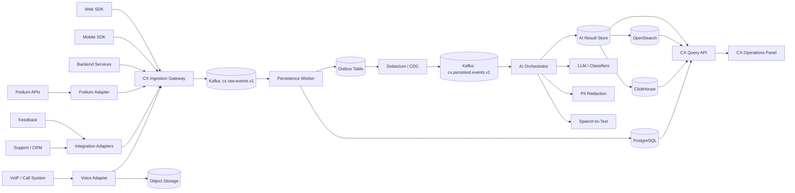
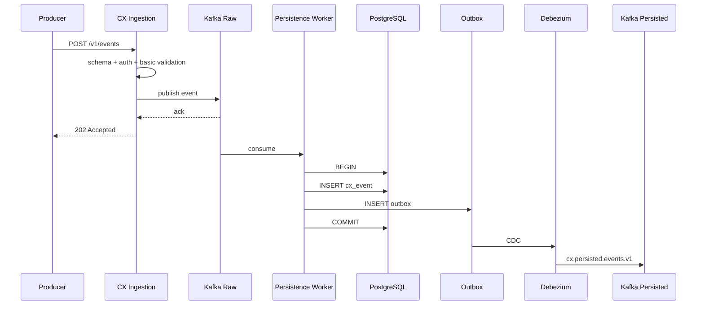
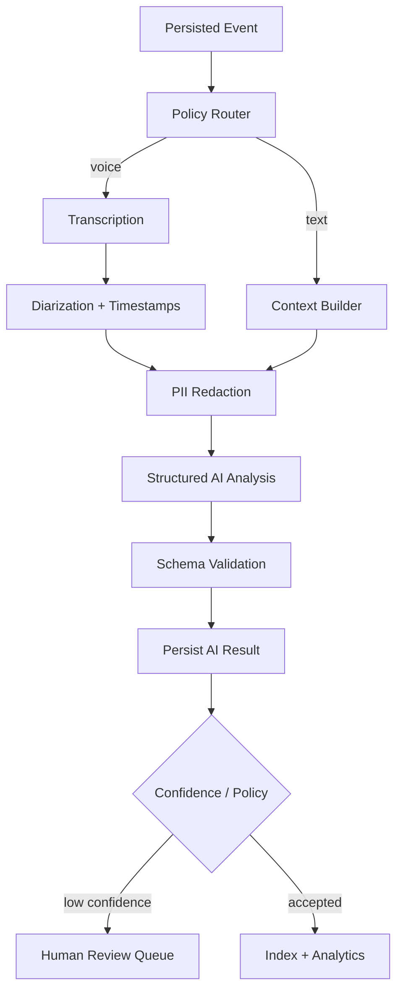

# technical design of the comprehensive system Customer Experience For products Podium

> Edition: 1.0
> Date: 2026-09-20
> Language: English
> Audience: Backend, Frontend, Data, AI/ML, DevOps, Security, CX

---

## 1. The purpose of the document

The purpose of this document is to define a technical architecture **CX Data & Intelligence Platform** For products Podium is able to user interactions, feedback, support requests, events APIRelated transactions, calls VoIP and collect the customer’s voice with a standard model, store reliably and then by AI Analyze and categorize.

The architecture is intentionally two Pipeline has an independent:

1. **Pipeline A — Capture & Persistence**
   - Receive event
   - validation
   - normalization
   - deduplication
   - persistence
   - outbox publication

2. **Pipeline B — AI Enrichment**
   - Receive only eventitems persist Done
   - Construction context
   - transcription If Voice
   - PII redaction
   - classification / sentiment / intent / summarization
   - Save the result AI With version
   - human review If needed

Key principle:

> AI It only works on data that is in Source of Truth Successfully persist has been.

---

## 2. Status Integration With Podium

At the time of preparing this document, `https://connector.example.invalid/docs` from the checking environment with an error HTTP 502 Could not be recovered. So nothing endpoint, webhook Or scope Certain of Podium It is not assumed in this document.

To avoid coupling, the actual connection to Podium Back one Adapter is placed:

```text
CX Core
  |
  +--> IPodiumConnector
          |
          +--> Podium API Adapter
          +--> Podium Webhook Adapter
          +--> Podium Scheduled Sync Adapter
```

After accessing the actual documentation Podium, only Mappingitems Adapter are completed and Core CX Does not change.

---

## 3. Principles of architecture

### 3.1 Event-first
All touchpointto one Canonical CX Event are converted.

### 3.2 Async by default
Registration CX It should not be in critical path Place the product.

### 3.3 Durable before AI
None eventBefore persistence enter the analysis AI It is not possible.

### 3.4 At-least-once + Idempotency
System delivery It assumes normality and with `event_id` And unique constraint It neutralizes it.

### 3.5 Immutable raw facts
Raw Event And Raw Audio They do not change. enrichmentitems versioned and are stored separately.

### 3.6 Replayable
Each Pipeline He should be able to eventReprocess the previous ones.

### 3.7 Privacy by design
PII, token, secret and sensitive data before sending to AI Control and if necessary mask It becomes.

---

## 4. Architectural macro view



---

## 5. Pipeline A — Capture & Persistence

### 5.1 Responsibility

Pipeline A Responsible for reliable receipt and maintenance only factitems CX is.

### 5.2 Flow



### 5.3 Transactional Outbox

In one transaction:

```sql
BEGIN;

INSERT INTO cx_event (...);

INSERT INTO cx_outbox (...);

COMMIT;
```

Consequently event persist and publication Next of state committed is made.

### 5.4 Idempotency

- `event_id` of producer Or gateway is produced.
- `UNIQUE(event_id)` In DB It is mandatory.
- consumer duplicate  success/no-op Considers.
- For batch ingestion Each item It has an independent result.
- producer retry It is allowed.

---

## 6. Canonical CX Event

### 6.1 Envelope

```json
{
  "event_id": "01J8YQ6J7W6B0R1S5D9V5J4A3F",
  "schema_version": "1.0",
  "event_name": "api.request.failed",
  "event_category": "product_interaction",
  "occurred_at": "2026-09-20T15:11:19.123Z",
  "received_at": "2026-09-20T15:11:19.241Z",
  "tenant_id": "bestcx",
  "customer": {
    "customer_id": "c_123",
    "anonymous_id": null,
    "business_id": "b_456"
  },
  "session": {
    "session_id": "s_789"
  },
  "source": {
    "type": "backend",
    "service": "payment-service",
    "channel": "api",
    "environment": "production"
  },
  "product": {
    "product_id": "product_x",
    "service_id": "service_y"
  },
  "interaction": {
    "action": "api_request",
    "result": "failed",
    "duration_ms": 426,
    "error_code": "AUTH_FAILED"
  },
  "context": {
    "trace_id": "4bf92f3577b34da6a3ce929d0e0e4736",
    "span_id": "00f067aa0ba902b7",
    "request_id": "req_123",
    "correlation_id": "corr_123"
  },
  "privacy": {
    "contains_pii": false,
    "classification": "internal"
  },
  "metadata": {}
}
```

### 6.2 Naming

Template:

```text
<domain>.<entity-or-action>.<state>
```

Example:

```text
user.session.started
page.viewed
form.submitted
api.request.succeeded
api.request.failed
feedback.submitted
support.ticket.created
support.ticket.resolved
voice.call.started
voice.call.ended
voice.recording.ready
voice.transcript.ready
```

Dynamic value Inside the name event It is forbidden.

---

## 7. Taxonomy Primary

### User / Session
- `user.session.started`
- `user.session.ended`
- `user.login.succeeded`
- `user.login.failed`

### Product Interaction
- `page.viewed`
- `button.clicked`
- `form.started`
- `form.submitted`
- `form.failed`
- `product.service.viewed`
- `product.service.activated`

### API
- `api.request.succeeded`
- `api.request.failed`
- `api.rate_limit.hit`
- `api.timeout`

### Feedback
- `feedback.submitted`
- `feedback.csat.submitted`
- `feedback.nps.submitted`
- `feedback.rating.submitted`

### Support
- `support.ticket.created`
- `support.ticket.assigned`
- `support.ticket.replied`
- `support.ticket.escalated`
- `support.ticket.resolved`
- `support.ticket.reopened`

### Voice
- `voice.call.started`
- `voice.call.answered`
- `voice.call.ended`
- `voice.call.dropped`
- `voice.recording.ready`
- `voice.transcript.ready`
- `voice.analysis.completed`

---

## 8. Kafka Design

### 8.1 Topicitems

| Topic | Key | Producer | Consumer | Purpose |
|---|---|---|---|---|
| `cx.raw.events.v1` | `tenant:customer` | Ingestion | Persistence | raw accepted events |
| `cx.persisted.events.v1` | `tenant:customer` | CDC | AI Orchestrator, Analytics | only committed events |
| `cx.voice.recording.ready.v1` | `call_id` | Voice Adapter | AI Orchestrator | recording is safely stored |
| `cx.ai.analysis.request.v1` | `entity_id` | AI Orchestrator | AI Worker | structured analysis jobs |
| `cx.ai.analysis.result.v1` | `entity_id` | AI Worker | Result Persister | model output |
| `cx.customer.timeline.updated.v1` | `tenant:customer` | Timeline Worker | Panel/CRM | derived timeline update |
| `cx.invalid.events.v1` | `event_id` | Validator | Ops | schema-invalid events |
| `cx.persistence.dlq.v1` | `event_id` | Persistence | Ops | unrecoverable persistence failure |
| `cx.ai.dlq.v1` | `entity_id` | AI Worker | Ops | unrecoverable AI failure |

### 8.2 Partitioning

For general interactions:

```text
key = tenant_id + ":" + customer_id
```

For voice job:

```text
key = call_id
```

### 8.3 Delivery

- producer idempotence be activated.
- `acks=all`
- retry With backoff
- consumer offset After success Logical commit Be.
- business-level deduplication Independent of Kafka Remain.

---

## 9. Storage

### 9.1 PostgreSQL

Source of Truth Operational:

- event metadata
- customer identities
- support metadata
- feedback metadata
- voice call metadata
- voice recording metadata
- transcript metadata
- AI analysis metadata
- outbox
- taxonomy
- human review
- audit log
- retention policy
- integration state

### 9.2 Object Storage

For payloadThe big ones and immutable:

- raw voice
- normalized voice
- large attachments
- transcript artifact
- model input/output archive If needed

Suggested route:

```text
cx/{tenant_id}/voice/{yyyy}/{mm}/{dd}/{call_id}/{recording_id}.wav
```

### 9.3 ClickHouse

For analytics With high volume:

- event fact table
- call metrics
- product metrics
- CX trend
- customer journey aggregates
- support/feedback aggregates

### 9.4 OpenSearch

For full-text:

- transcript
- support ticket text
- feedback comments
- AI summaries

---

## 10. Operational data model

### 10.1 cx_event

```sql
CREATE TABLE cx_event (
    id BIGSERIAL PRIMARY KEY,
    event_id VARCHAR(64) NOT NULL UNIQUE,
    tenant_id VARCHAR(64) NOT NULL,
    customer_id VARCHAR(128),
    anonymous_id VARCHAR(128),
    session_id VARCHAR(128),
    event_name VARCHAR(160) NOT NULL,
    event_category VARCHAR(80) NOT NULL,
    schema_version VARCHAR(16) NOT NULL,
    occurred_at TIMESTAMPTZ NOT NULL,
    received_at TIMESTAMPTZ NOT NULL,
    source_type VARCHAR(32),
    source_service VARCHAR(128),
    product_id VARCHAR(128),
    service_id VARCHAR(128),
    trace_id VARCHAR(64),
    correlation_id VARCHAR(128),
    payload JSONB NOT NULL,
    created_at TIMESTAMPTZ NOT NULL DEFAULT now()
);

CREATE INDEX ix_cx_event_customer_time
ON cx_event (tenant_id, customer_id, occurred_at DESC);

CREATE INDEX ix_cx_event_name_time
ON cx_event (event_name, occurred_at DESC);
```

### 10.2 cx_outbox

```sql
CREATE TABLE cx_outbox (
    id UUID PRIMARY KEY,
    aggregate_type VARCHAR(64) NOT NULL,
    aggregate_id VARCHAR(128) NOT NULL,
    event_type VARCHAR(160) NOT NULL,
    partition_key VARCHAR(256) NOT NULL,
    payload JSONB NOT NULL,
    created_at TIMESTAMPTZ NOT NULL DEFAULT now()
);
```

### 10.3 ai_analysis

```sql
CREATE TABLE ai_analysis (
    id UUID PRIMARY KEY,
    tenant_id VARCHAR(64) NOT NULL,
    entity_type VARCHAR(32) NOT NULL,
    entity_id VARCHAR(128) NOT NULL,
    analysis_type VARCHAR(64) NOT NULL,
    model_provider VARCHAR(64) NOT NULL,
    model_name VARCHAR(128) NOT NULL,
    model_version VARCHAR(64),
    prompt_version VARCHAR(64),
    taxonomy_version VARCHAR(64),
    result JSONB NOT NULL,
    confidence NUMERIC(5,4),
    status VARCHAR(32) NOT NULL,
    created_at TIMESTAMPTZ NOT NULL DEFAULT now(),
    supersedes_analysis_id UUID NULL
);
```

---

## 11. Voice/VoIP As First-Class Data Source

Voice Should not be in the form blob Inside event Or Kafka be placed.

Correct pattern:

```text
VoIP Provider
   |
   +--> Call Metadata --> CX Event
   |
   +--> Recording Stream/File
             |
             v
        Object Storage
             |
        checksum verify
             |
             v
      recording READY
             |
             v
      cx.persisted.events
```

Atomicity Middle Object Storage And PostgreSQL One ACID transaction does not have a common; So from state machine And idempotent workflow is used:

```text
DISCOVERED
  -> STAGING
  -> STORED
  -> VERIFIED
  -> READY
  -> TRANSCRIBED
  -> ANALYZED
```

Only in `READY` The analyzable event is published.

---

## 12. Pipeline B — AI Enrichment

### 12.1 Flow



### 12.2 Standard output

```json
{
  "analysis_version": "1.0",
  "sentiment": "negative",
  "intent": "technical_support",
  "category": "authentication",
  "subcategory": "credential_configuration",
  "severity": "high",
  "journey_stage": "activation",
  "resolution_status": "unresolved",
  "summary": "Customer experienced repeated authentication failures before contacting support.",
  "action_items": [
    "Review credential configuration",
    "Follow up with customer"
  ],
  "confidence": 0.91
}
```

### 12.3 Context Builder

AI Shouldn’t be just one event see alone.

Context policy Example:

```text
Current event
+ previous 20 events
+ events in last 30 minutes
+ open support case
+ latest feedback
+ active product/service
```

Limits configurable be.

---

## 13. AI Governance

Save for each result:

- `model_provider`
- `model_name`
- `model_version`
- `prompt_version`
- `taxonomy_version`
- `input_hash`
- `confidence`
- `created_at`
- `supersedes_analysis_id`

Principle:

> Outbound AI update-in-place It is not possible; A new version is created.

Human override should also be stored independently and audit have.

---

## 14. API Surface

### Ingestion

```http
POST /v1/events
POST /v1/events/batch
```

### Customer

```http
GET /v1/customers/{customerId}
GET /v1/customers/{customerId}/timeline
GET /v1/customers/{customerId}/insights
```

### Events

```http
GET /v1/events
GET /v1/events/{eventId}
```

### Feedback

```http
GET /v1/feedback
GET /v1/feedback/{id}
PATCH /v1/feedback/{id}/review
```

### Support

```http
GET /v1/support/cases
GET /v1/support/cases/{id}
```

### Voice

```http
GET /v1/voice/calls
GET /v1/voice/calls/{callId}
GET /v1/voice/calls/{callId}/transcript
POST /v1/voice/calls/{callId}/reprocess
```

### AI Review

```http
GET /v1/ai/reviews
POST /v1/ai/reviews/{analysisId}/approve
POST /v1/ai/reviews/{analysisId}/override
POST /v1/ai/reviews/{analysisId}/reject
```

### Admin

```http
GET /v1/admin/pipelines
GET /v1/admin/integrations
GET /v1/admin/data-quality
GET /v1/admin/taxonomies
POST /v1/admin/taxonomies
POST /v1/admin/reprocess
```

---

## 15. CX Panel

Operating panel CX of Query API uses and direct to Kafka or raw tables are not connected.

Modules:

1. Overview
2. Customer 360
3. Unified Feedback & Support
4. Voice Review
5. AI Review Queue
6. Product Experience
7. Journey Analytics
8. Taxonomy Management
9. Data Quality
10. Pipeline Health
11. Integrations
12. Audit & Security

Full description in document `02-cx-panel-proposal-en.md` has arrived.

---

## 16. Observability

### Correlation fields

Min:

- `event_id`
- `trace_id`
- `span_id`
- `request_id`
- `correlation_id`
- `customer_id`
- `session_id`
- `call_id` For voice

### Metrics

- ingest rate
- Kafka lag
- invalid event rate
- dedup rate
- persistence latency
- outbox lag
- AI queue latency
- AI error rate
- transcription latency
- transcription confidence
- human review backlog
- panel API latency

### Tracing

W3C Trace Context And OpenTelemetry It is suggested.

---

## 17. Security

### Prohibited in event payload

- password
- access token
- refresh token
- API secret
- CVV
- full card number
- raw authentication credential

### Controls

- TLS everywhere
- encryption at rest
- object storage signed URL
- RBAC
- least privilege
- tenant isolation
- PII classification
- audit log
- retention policy
- deletion/anonymization workflow
- configurable AI redaction policy

For call recording rules, user consent and retention should be the legal policy of the organization and the relevant jurisdiction deployment be checked; This document does not issue a legal ruling.

---

## 18. Non-Functional Requirements

### Availability

MVP target Suggestion:

- Ingestion API: 99.9%
- Query API: 99.9%
- AI enrichment: eventual, Apart from availability Product

### Performance

- Ingestion p95 Below 150ms To receive Kafka ack, under load Goal
- Panel common queries p95 Below 1s
- heavy analytical queries Below 5s
- batch ingestion For eventitems frontend

These numbers target are primary and should be after load test be stabilized.

### Scalability

- stateless ingestion
- horizontally scalable consumers
- Kafka partition-based scale
- Object Storage For voice
- ClickHouse For analytics

---

## 19. Failure Handling

| Failure | Behavior |
|---|---|
| Kafka unavailable | ingestion retry / fail fast According to policy, no block Infinity |
| duplicate event | no-op success |
| DB temporary error | consumer retry |
| DB permanent error | persistence DLQ |
| AI provider unavailable | retry + circuit breaker |
| invalid AI JSON | schema repair limited retry Then DLQ |
| STT failure | transcription retry; raw audio It is maintained |
| object upload incomplete | state != READY; AI It is not implemented |
| panel unavailable | ingestion And AI They continue |

---

## 20. Data Lifecycle

```text
RAW FACT
  -> PERSISTED
  -> NORMALIZED
  -> ENRICHED
  -> INDEXED
  -> REVIEWED
  -> ARCHIVED / DELETED PER POLICY
```

Each stage Must be able audit be.

---

## 21. Phasing

### Phase 0 — Foundation
- Event schema
- Kafka
- PostgreSQL
- Outbox
- basic ingestion
- observability

### Phase 1 — Core CX
- frontend interaction
- backend/API interaction
- feedback
- support
- Customer 360
- basic CX panel

### Phase 2 — Voice
- VoIP adapter
- object storage
- transcription
- diarization
- voice review UI
- call analytics

### Phase 3 — AI Intelligence
- structured classification
- sentiment
- intent
- severity
- summary
- journey context
- human review

### Phase 4 — Advanced CX
- root-cause clustering
- product health
- alerting
- risk signals
- cohort/journey analytics
- automated workflow integrations

---

## 22. Acceptance Criteria

### Ingestion
- Each event Has `event_id` is.
- event Repetitive duplicate business record does not make.
- schema-invalid event Visible.
- producer retry It is safe.

### Persistence
- event And outbox In one DB transaction are written.
- Only event committed Ward persisted topic It becomes.
- replay cause corruption It is not possible.

### Voice
- audio Inside Kafka Not saved.
- recording checksum And metadata has.
- AI Only recording With state=`READY` processes.
- transcript Has speaker And timestamp is.

### AI
- Each result Has model/prompt/taxonomy version is.
- original event Does not change.
- low-confidence Able human review is.
- reprocessing Produces a new version.

### Panel
- CX user It can customer timeline . See.
- call to broadcast and transcript synced See.
- AI labels  approve/override Slow down.
- feedback/support  filter And manage Slow down.
- audit history Be visible.

---

## 23. Suggested technical resources

- Apache Kafka Producer / Idempotence / Transactions: https://kafka.apache.org/
- Debezium Outbox Event Router: https://debezium.io/documentation/reference/transformations/outbox-event-router.html
- OpenTelemetry Event Semantic Conventions: https://opentelemetry.io/docs/specs/semconv/general/events/
- OpenTelemetry Session Conventions: https://opentelemetry.io/docs/specs/semconv/general/session/
- W3C Trace Context: https://www.w3.org/TR/trace-context/

---

## 24. Final architectural decision

The core of the system:

```text
Collect -> Kafka Raw -> Persist + Outbox -> Kafka Persisted -> AI -> Review/Analytics
```

And for Voice:

```text
Call Metadata -> Event Pipeline
Audio -> Object Storage -> READY Event -> STT -> AI -> Human Review / Analytics
```

This separation It causes **reliability, replay, scalability, auditability And AI evolution** Without linking the main products Podium To the service CX To be maintained.
