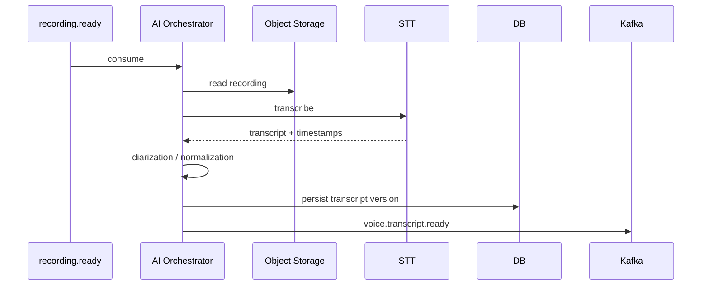

# The design of collecting and analyzing the customer’s voice and VoIP For the system CX

> Edition: 1.0
> Goal: Definition of architecture Voice-of-Customer For contacts VoIP, recording, transcript And AI analysis

---

## 1. Why Voice Should First-Class be

Voice call is usually the richest resource CX because in a conversation you can see the following things:

- The reason for the call
- Actual customer problem
- Product or service involved
- Customer’s previous efforts
- Support response quality
- resolved/unresolved
- follow-up
- Repetitive frictions
- Documentation or process gaps

Therefore Voice Shouldn’t be just one attachment aside Ticket be.

Correct model:

```text
Call
  +-- Participants
  +-- Metadata
  +-- Recording(s)
  +-- Transcript
  +-- Transcript Segments
  +-- AI Analysis
  +-- Human Review
  +-- Links to Customer/Product/Ticket
```

---

## 2. Input sources

The system should have several models integration to support:

### Webhook-based

VoIP provider Events like call started / ended / recording ready Sends.

### Pull-based

If webhook do not exist:

```text
Scheduler -> VoIP Adapter -> fetch calls since cursor
```

### Direct Recording Upload

For the internal system:

```text
POST recording metadata
-> pre-signed upload
-> complete callback
```

### Streaming

In MVP It is not necessary. In the next phase, it is possible real-time transcription added Select.

---

## 3. Call Lifecycle

```text
DISCOVERED
  -> RINGING
  -> ANSWERED
  -> ENDED
  -> RECORDING_DISCOVERED
  -> RECORDING_STAGING
  -> RECORDING_STORED
  -> RECORDING_VERIFIED
  -> READY_FOR_TRANSCRIPTION
  -> TRANSCRIBING
  -> TRANSCRIBED
  -> ANALYZING
  -> ANALYZED
  -> REVIEWED
```

Each transition One event Makes a standard.

---

## 4. Voice Metadata Event

```json
{
  "event_id": "01J...",
  "schema_version": "1.0",
  "event_name": "voice.call.ended",
  "event_category": "voice",
  "occurred_at": "2026-09-20T15:11:19Z",
  "tenant_id": "bestcx",
  "customer": {
    "customer_id": "c_123"
  },
  "source": {
    "type": "voip",
    "service": "contact-center"
  },
  "voice": {
    "call_id": "call_123",
    "direction": "inbound",
    "agent_id": "agent_45",
    "queue_id": "support",
    "duration_ms": 721000,
    "end_reason": "completed"
  },
  "context": {
    "correlation_id": "ticket_991"
  }
}
```

---

## 5. Audio Storage

### Principle

audio file on Kafka It is not placed.

### Object Metadata

For each recording:

```text
recording_id
call_id
object_key
content_type
codec
sample_rate
channels
size_bytes
duration_ms
checksum_sha256
encryption_key_ref
storage_state
created_at
verified_at
```

### Integrity

After upload:

1. size validate
2. checksum validate
3. media probe
4. duration validate
5. malware/security scan If policy
6. set state=`READY`

Only after READY, event `voice.recording.ready` be published.

---

## 6. Data model Voice

### voice_call

```sql
CREATE TABLE voice_call (
    id UUID PRIMARY KEY,
    tenant_id VARCHAR(64) NOT NULL,
    call_id VARCHAR(128) NOT NULL,
    customer_id VARCHAR(128),
    agent_id VARCHAR(128),
    queue_id VARCHAR(128),
    direction VARCHAR(16),
    started_at TIMESTAMPTZ,
    answered_at TIMESTAMPTZ,
    ended_at TIMESTAMPTZ,
    duration_ms BIGINT,
    end_reason VARCHAR(64),
    provider VARCHAR(64),
    provider_call_id VARCHAR(128),
    correlation_id VARCHAR(128),
    created_at TIMESTAMPTZ NOT NULL DEFAULT now(),
    UNIQUE (tenant_id, call_id)
);
```

### voice_recording

```sql
CREATE TABLE voice_recording (
    id UUID PRIMARY KEY,
    call_id UUID NOT NULL REFERENCES voice_call(id),
    object_key TEXT NOT NULL,
    content_type VARCHAR(128),
    codec VARCHAR(32),
    sample_rate INT,
    channels INT,
    size_bytes BIGINT,
    duration_ms BIGINT,
    checksum_sha256 VARCHAR(64),
    storage_state VARCHAR(32) NOT NULL,
    created_at TIMESTAMPTZ NOT NULL DEFAULT now(),
    verified_at TIMESTAMPTZ
);
```

### voice_transcript

```sql
CREATE TABLE voice_transcript (
    id UUID PRIMARY KEY,
    recording_id UUID NOT NULL REFERENCES voice_recording(id),
    language VARCHAR(16),
    engine VARCHAR(64) NOT NULL,
    model VARCHAR(128) NOT NULL,
    model_version VARCHAR(64),
    status VARCHAR(32) NOT NULL,
    average_confidence NUMERIC(5,4),
    transcript_text TEXT,
    artifact_object_key TEXT,
    created_at TIMESTAMPTZ NOT NULL DEFAULT now()
);
```

### voice_transcript_segment

```sql
CREATE TABLE voice_transcript_segment (
    id BIGSERIAL PRIMARY KEY,
    transcript_id UUID NOT NULL REFERENCES voice_transcript(id),
    segment_index INT NOT NULL,
    speaker VARCHAR(32),
    speaker_ref VARCHAR(128),
    start_ms BIGINT NOT NULL,
    end_ms BIGINT NOT NULL,
    text TEXT NOT NULL,
    confidence NUMERIC(5,4),
    UNIQUE(transcript_id, segment_index)
);
```

---

## 7. Transcription Pipeline



---

## 8. Diarization

Min speaker labels:

```text
customer
agent
unknown
```

If provider channel-separated audio Give, from channel mapping be used because of diarization It is a more reliable estimate.

Transcript segment Should start/end timestamp have to UI Can text with audio sync Slow down.

---

## 9. English Speech Considerations

For English language test set Real organization is necessary.

Items that should benchmark become:

- Name of the product
- Service name
- Banking terms/Payment
- Codes and numbers
- Names of companies
- Accents
- Call center noise
- Low quality mobile calls

Custom vocabulary / phrase hints If supported engine It has a high value.

---

## 10. PII Redaction

Two versions transcript It is suggested:

```text
raw transcript
redacted transcript
```

Access raw Only for role Limited.

EntityAble mask According to policy:

- phone
- national identifier
- card/account identifiers
- email
- address
- credential-like strings

AI General preferably redacted transcript to receive.

---

## 11. AI Analysis

Input:

```text
call metadata
+ transcript
+ previous customer events
+ open support case
+ related product
+ recent failures
```

Output:

```json
{
  "call_reason": "integration_failure",
  "intent": "technical_support",
  "category": "authentication",
  "subcategory": "invalid_credentials",
  "sentiment": "negative",
  "resolution_status": "unresolved",
  "severity": "high",
  "follow_up_required": true,
  "mentioned_products": ["service-x"],
  "summary": "...",
  "key_moments": [
    {
      "start_ms": 121000,
      "end_ms": 142000,
      "type": "problem_statement",
      "summary": "..."
    }
  ],
  "action_items": ["..."],
  "confidence": 0.89
}
```

---

## 12. Observable Call Metrics

Metrics Technical/Direct behavior:

- duration
- ring time
- hold time
- silence ratio
- overlap duration
- interruption count
- customer talk ratio
- agent talk ratio
- transfer count
- reconnect
- drop reason
- first response delay

This metrics Better than the direct inference of mental state from measurable sound and audit are.

---

## 13. Key Moment Detection

AI It can timestampthe important ones mark Slow down:

```text
problem_statement
customer_complaint
agent_commitment
resolution
escalation
pricing_issue
product_issue
security_warning
follow_up_request
```

CX reviewer By clicking, the sound is transferred directly to the same second.

---

## 14. Linking Voice to Customer 360

Correlation priority:

1. explicit customer id
2. support ticket correlation
3. authenticated account
4. verified phone mapping
5. provider metadata
6. unresolved identity queue

Identity merge Should audit Be.

---

## 15. Voice Kafka Topics

```text
cx.voice.call.events.v1
cx.voice.recording.ready.v1
cx.voice.transcription.request.v1
cx.voice.transcription.result.v1
cx.voice.analysis.request.v1
cx.voice.analysis.result.v1
cx.voice.dlq.v1
```

Top-level architecture Still two Pipeline has a main; this topicitems sub-flowitems Voice Inside Persistence And AI Enrichment are.

---

## 16. Retry / Idempotency

Job key:

```text
recording_id + operation + model_version
```

Example:

```text
rec_123:transcribe:stt-v4
rec_123:analyze:cx-prompt-v7
```

Unique job key It causes retry duplicate result Do not make.

---

## 17. Reprocessing

Scenarios reprocess:

- STT model New
- glossary New
- diarization Better
- taxonomy New
- LLM New
- prompt New
- bug fix

Principle:

> Do not delete the previous version; New version supersede Slow down.

---

## 18. Retention

Retention Should policy-based And configurable be.

separately:

- raw audio retention
- transcript retention
- redacted transcript retention
- AI result retention
- audit retention

Delete the audio file should metadata tombstone/audit Leave if policy The organization allows.

---

## 19. Security

- encryption at rest
- TLS
- short-lived signed URL
- no public bucket
- per-role audio permission
- download permission Apart from listen
- watermark/logging If needed
- audit Each audio access
- no voice file in logs
- no secret in transcript
- legal/consent policy integration

---

## 20. Voice Panel Acceptance Criteria

- Call based customer/call/date/agent/product Searchable.
- audio player seek And speed has.
- transcript With audio synced is.
- speaker segment is displayed.
- key moment The user to timestamp Takes.
- AI summary/category/severity Able review is.
- reviewer It can label  override Slow down.
- reprocess Makes a new version.
- raw audio download To permission It needs separate.
- All sensitive accesses audit are.

---

## 21. MVP Suggestion Voice

### MVP-1
- import call metadata
- recording storage
- basic call list
- playback

### MVP-2
- STT
- timestamps
- diarization
- transcript search

### MVP-3
- AI category/sentiment/summary
- human review
- Customer 360 linking

### MVP-4
- key moments
- quality metrics
- alerting
- batch reprocessing
